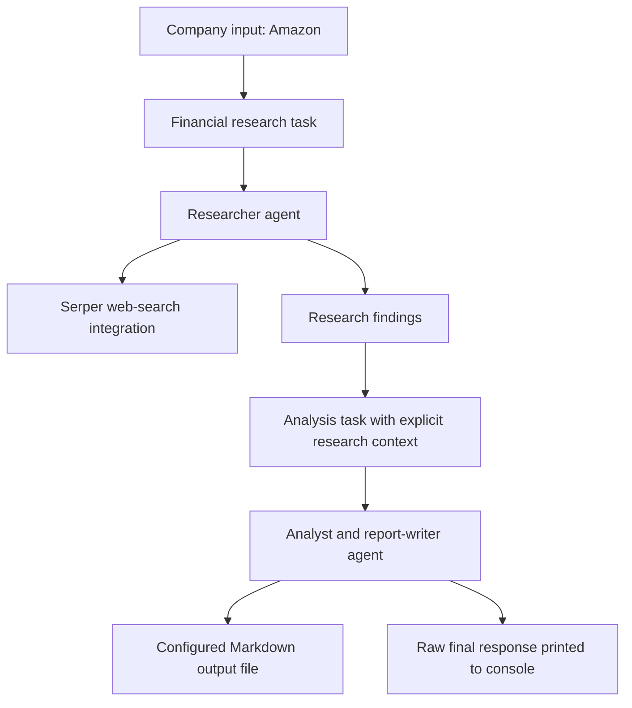

# Financial Research and Analyst Crew

### Separate research from analysis. Turn company information into a readable report.

A **Python and CrewAI company-research prototype** designed around two complementary roles: a researcher that gathers company information through web search, and an analyst that turns those findings into a structured Markdown report.

The project explores a practical application of multi-agent orchestration: define a company, delegate information gathering, pass the findings into a dedicated analysis task, and produce a document organized for human review.

[Explore the orchestration](./financial_analyst/src/financial_analyst/crew.py) · [Read the task definitions](./financial_analyst/src/financial_analyst/config/tasks.yaml) · [View the saved Amazon report](./financial_analysis_report.md)

> **Project stage:** Source prototype with a committed example report. The current code contains startup and configuration issues described below. The saved report demonstrates the intended document format; it does not prove a successful run of the current checkout or verified financial accuracy. No model or search calls were made for this documentation.

---

## The problem

Company research combines two different kinds of work: gathering relevant information and explaining what it means. A useful report needs both coverage and clarity—financial performance, business risks, recent developments, opportunities, and an outlook that a reader can follow.

This project expresses that division as an explicit workflow. The research task defines the information to collect. The analysis task receives the research as context and asks for a report with an executive summary, findings, analysis, and conclusion.

## Intended business value

| Research requirement | Project approach |
|---|---|
| Start with a company-specific brief | A `company` input is interpolated into roles and tasks |
| Cover a repeatable set of topics | Research instructions enumerate five areas of investigation |
| Separate information gathering from interpretation | Two specialized agents and two sequential tasks |
| Carry findings into the final report | Explicit research-to-analysis task context |
| Produce an accessible deliverable | Markdown report with headings and an executive summary |
| Keep behavior understandable and editable | YAML prompts separated from Python orchestration |

The intended benefit is a repeatable first-draft research process. Research-time savings, factual accuracy, analyst productivity, and investment outcomes have not been measured.

## Workflow design



This diagram represents the intended workflow. The current implementation needs the corrections listed in **Current implementation gaps** before that path can be treated as operational.

### Two specialized roles

| Agent | Intended responsibility | Tool configuration |
|---|---|---|
| `financial_researcher` | Investigate financial performance, news, and company potential | Serper search is intended, but its reference needs correction |
| `financial_analyst` | Analyze the findings and write an accessible report | No explicit tools attached |

The crew uses `Process.sequential`. There is no manager agent, autonomous reviewer, or separate fact-checking stage.

### Research scope

The research task requests five areas:

1. Current company status and financial health.
2. Historical and current financial performance.
3. Challenges and opportunities.
4. Recent news and events.
5. Outlook, projections, and potential developments.

The analysis task then requests an executive summary, key findings, trend interpretation, outlook, and conclusion. It also asks for a reminder to conduct independent research before making trading or investment decisions.

### Handoff and artifact

The analysis YAML declares:

```yaml
context:
  - financial_research_task
```

Its configured output destination is:

```text
output/financial_analysis_report.md
```

That path is relative to the launch directory. The separately committed example report is at the repository root as `financial_analysis_report.md`; the repository does not establish the provenance connecting that file to the current code.

## Included example report

The [saved Amazon report](./financial_analysis_report.md) demonstrates the intended presentation:

- Executive summary.
- Company status and financial health.
- Historical and current performance.
- Challenges and opportunities.
- News and events.
- Outlook and potential developments.
- Conclusion and an investment-research disclaimer.

It discusses e-commerce, cloud services, advertising, operational challenges, and growth themes in one document. This is evidence of a report artifact, not evidence that its claims are accurate.

### Evidence and freshness boundaries

The example introduces itself as an analysis as of 2023 while also discussing later projections. It does not attach source URLs or claim-level citations, record retrieval times, or consistently distinguish reporting periods from forecast periods. Its figures and predictions should therefore be treated as unverified historical generated content.

The implementation does not include a financial-statement ingestion pipeline, ratio-calculation engine, market-data feed, valuation model, backtest, or independent numerical validation. The term “analysis” here refers to model-generated interpretation of research context.

## Engineering skills demonstrated

### Multi-agent task decomposition

The project separates research and report writing into different agent roles, rather than asking one undifferentiated prompt to perform the entire job.

### Explicit task dependencies

The analysis task references the research task as context, making the intended information flow visible in configuration.

### Prompt engineering for report coverage

The prompts specify research dimensions, required sections, audience-friendly language, and the final document structure.

### Tool integration and document output

The source introduces Serper search through CrewAI tools and configures a Markdown report as the final deliverable. The search-tool binding currently needs repair.

### Packaging and dependency management

The project includes package metadata, console entry points, a Python compatibility range, and a committed `uv.lock` resolving CrewAI `0.130.0`.

## Current implementation gaps

### 1. Configuration paths omit the `config/` directory

`crew.py` declares `agents_config = 'agents.yaml'` and `tasks_config = 'tasks.yaml'`, but those files are committed under `src/financial_analyst/config/`.

CrewAI's version-matched loader resolves these paths relative to the crew class directory. The paths therefore need to match the nested location. See the [CrewAI 0.130.0 configuration loader](https://github.com/crewAIInc/crewAI/blob/0.130.0/src/crewai/project/crew_base.py).

### 2. The search-tool reference is unqualified

`web_search_tool = SerperDevTool()` is declared as a class attribute, but `financial_researcher()` uses `tools=[web_search_tool]`. A method does not automatically resolve a bare variable name from its class namespace. The tool must be referenced through the instance/class or moved to an appropriate enclosing scope.

### 3. The analysis task looks up the wrong YAML key

The task method reads:

```python
self.tasks_config['financial_analyst_task']
```

The actual YAML key is `financial_analysis_task`. These names need to agree.

### 4. Intended model choices are not reliably bound

The agent YAML uses `model: openai/gpt-4o` for research and `model: groq/llama-3.1-70b-versatile` for analysis. The locked CrewAI agent exposes selection through `llm`; the constructors do not pass explicit `llm` arguments.

The existing entries should not be presented as proof that those models executed the saved report. Correct provider binding and verify current model availability before running. See the [version-matched agent implementation](https://github.com/crewAIInc/crewAI/blob/0.130.0/src/crewai/agent.py).

### 5. Template scripts point to missing functions

`financial_analyst` and `run_crew` target the implemented `run()` function. `train`, `replay`, and `test` reference functions absent from `main.py`.

### 6. Report quality is prompted, not independently checked

The source does not attach a Pydantic report schema, citation validator, financial-claim checker, or review guardrail. Professional formatting does not establish factual reliability.

## Repository structure

```text
Financial-Research-and-Analyst-Crew/
├── README.md
├── financial_analysis_report.md       # Committed example report
└── financial_analyst/
    ├── README.md
    ├── pyproject.toml
    ├── uv.lock
    ├── knowledge/
    │   └── user_preference.txt
    └── src/financial_analyst/
        ├── __init__.py
        ├── main.py
        ├── crew.py
        ├── config/
        │   ├── agents.yaml
        │   └── tasks.yaml
        └── tools/
            ├── __init__.py
            └── custom_tool.py
```

`custom_tool.py` contains a template tool that returns a placeholder response; it is not attached to either agent. `knowledge/user_preference.txt` contains sample profile text and is not wired as a knowledge source. Neither file establishes implemented personalization or retrieval-augmented research.

## Development setup

The project declares Python `>=3.10,<3.14`, `crewai[tools]>=0.130.0,<1.0.0`, and Hatchling as its build backend. The lockfile records a CrewAI `0.130.0` environment.

```bash
git clone https://github.com/FaiazS/Financial-Research-and-Analyst-Crew.git
cd Financial-Research-and-Analyst-Crew/financial_analyst
uv sync --locked
```

Before executing:

1. Correct the YAML paths, search-tool reference, analysis-task key, and model bindings.
2. Configure `SERPER_API_KEY` and credentials for the providers actually selected. The intended OpenAI/Groq setup would require `OPENAI_API_KEY` and `GROQ_API_KEY` respectively.
3. Keep credentials outside source control. `main.py` calls `load_dotenv()` before invoking the crew.
4. Review the company input, currently fixed to `Amazon`, and the report instructions.
5. Launch from a consistent directory so the relative output path is predictable.

After those corrections, the implemented console entry point is:

```bash
uv run run_crew
```

This is the intended development entry point, not a verified successful command for the unchanged checkout. Actual execution sends prompts to model providers, can invoke Serper, consumes applicable API quota, and writes the configured report. No dependencies were installed and no execution or tests were performed for this documentation.

## Next engineering milestones

1. **Repair startup and configuration:** Align names and paths, bind providers explicitly, and validate required credentials before kickoff.
2. **Make research reproducible:** Record company identifiers, an as-of date, reporting periods, model configuration, and source retrieval timestamps.
3. **Require supporting evidence:** Attach primary-source links to material claims and distinguish retrieved facts, calculations, forecasts, and model interpretation.
4. **Add numerical verification:** Ingest authoritative filings and calculate key metrics with deterministic code before asking the analyst to interpret them.
5. **Validate the report:** Check required sections, citation coverage, unsupported figures, and consistency of dates and units.
6. **Capture a verified demonstration:** Preserve sanitized research inputs, tool traces, the final report, and review results from a reproducible run.
7. **Improve the interface and reliability:** Accept a validated company argument, add timeouts and actionable errors, and evaluate report quality, cost, and latency.

These are proposed improvements, not delivered functionality. No trading, portfolio management, or production-hosted service is implemented.

## Why I built this

My business education and operations background make structured research and clear communication meaningful problems to work on. This project applies those priorities to agentic software: define responsibilities, organize a handoff, and produce an understandable artifact.

Its strongest portfolio story is the translation of a business research process into a two-agent workflow. The next engineering step is to make that workflow reproducible and attach verifiable evidence to its conclusions.

---

**Author:** [Faiaz Ahmed](https://www.linkedin.com/in/faiazahmed22/) · [GitHub](https://github.com/FaiazS)

